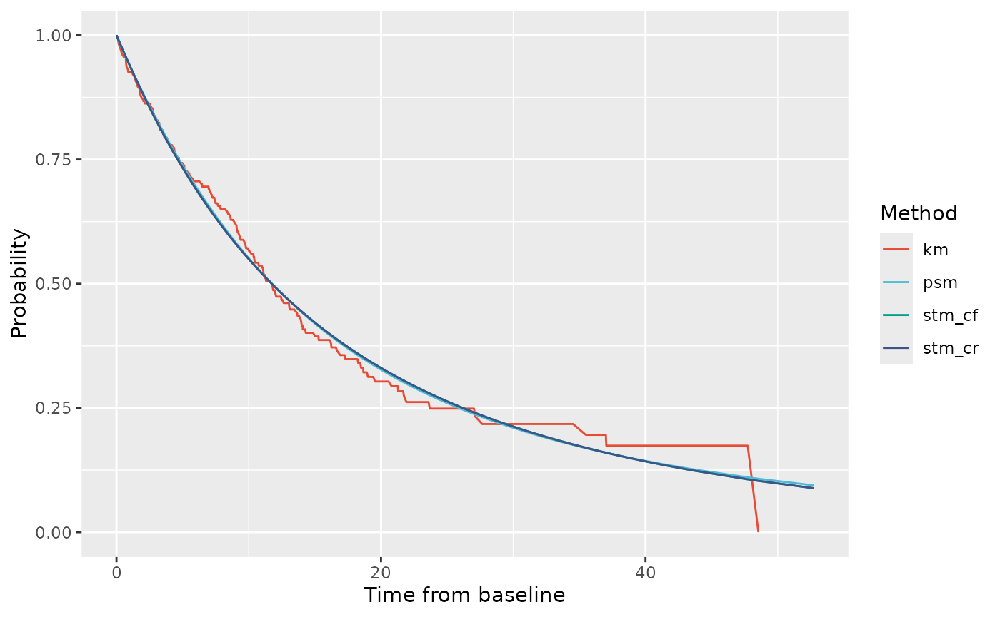
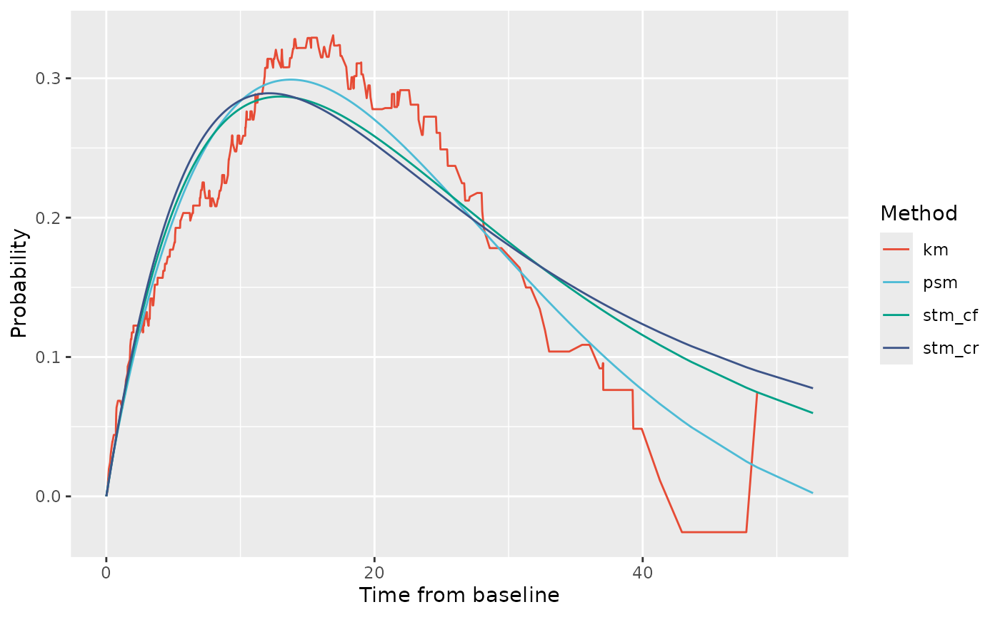
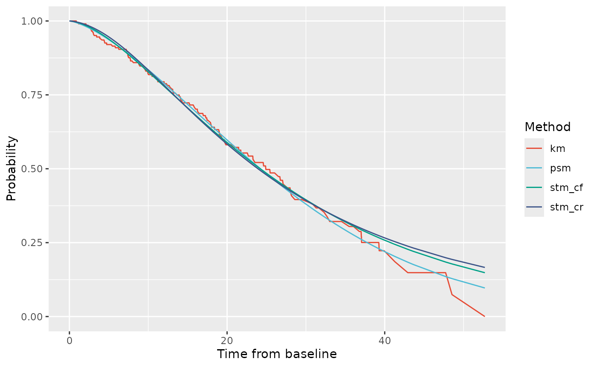
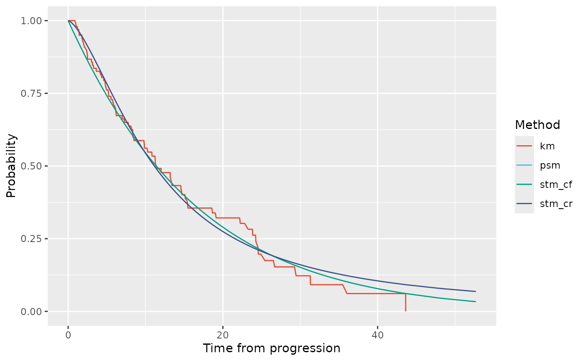

# Example use of psm3mkv

## Introduction

This vignette walks through evaluating the partitioned survival model
(PSM) and state transition model structures (either clock reset, STM-CR,
or clock forward types, STM-CF) to a dataset derived from the `bosms3`
dataset that comes with the flexsurv package (Jackson 2016). A review of
PSMs and STMs in oncology cost-effectiveness models is provided by Woods
et al. (2020).

First we need to load the packages of interest. If you haven’t installed
psm3mkv yet, please see the [installation
instructions](https://github.com/Merck/psm3mkv?tab=readme-ov-file#installation)
to install it with all its dependencies. We will also be using Angelo
Canty and B. D. Ripley (2024), Xiao (2024) and Wickham and Henry (2023).

``` r

library("boot")
library("ggsci")
library("psm3mkv")
library("purrr")
```

## Obtaining a suitable dataset

First we create a suitable patient-level dataset using
[`create_dummydata()`](https://merck.github.io/psm3mkv/reference/create_dummydata.md).
Here we load data derived from the `bosms3` dataset with the flexsurv
package (Jackson 2016).

``` r

# Create and review the dummy dataset
bosonc <- create_dummydata("flexbosms")
head(bosonc)
#> # A tibble: 6 × 7
#>    ptid pfs.durn pfs.flag os.durn os.flag ttp.durn ttp.flag
#>   <int>    <dbl>    <dbl>   <dbl>   <dbl>    <dbl>    <dbl>
#> 1     1   18.7          1   42.9        1   18.7          1
#> 2     2   12.0          1   23.3        1   12.0          1
#> 3     3    0.452        1    8.81       1    0.452        1
#> 4     4    9.07         1   52.7        1    9.07         1
#> 5     5   47.7          0   47.7        0   47.7          0
#> 6     6    3.26         1   13.1        1    3.26         1
summary(bosonc)
#>       ptid           pfs.durn          pfs.flag         os.durn      
#>  Min.   :  1.00   Min.   : 0.1071   Min.   :0.0000   Min.   : 0.881  
#>  1st Qu.: 51.75   1st Qu.: 4.2381   1st Qu.:0.0000   1st Qu.: 7.893  
#>  Median :102.50   Median : 9.7262   Median :1.0000   Median :15.226  
#>  Mean   :102.50   Mean   :11.5630   Mean   :0.6471   Mean   :17.055  
#>  3rd Qu.:153.25   3rd Qu.:16.2321   3rd Qu.:1.0000   3rd Qu.:22.729  
#>  Max.   :204.00   Max.   :48.5357   Max.   :1.0000   Max.   :52.702  
#>     os.flag          ttp.durn          ttp.flag     
#>  Min.   :0.0000   Min.   : 0.1071   Min.   :0.0000  
#>  1st Qu.:0.0000   1st Qu.: 4.2381   1st Qu.:0.0000  
#>  Median :0.0000   Median : 9.7262   Median :1.0000  
#>  Mean   :0.4755   Mean   :11.5630   Mean   :0.5049  
#>  3rd Qu.:1.0000   3rd Qu.:16.2321   3rd Qu.:1.0000  
#>  Max.   :1.0000   Max.   :48.5357   Max.   :1.0000
```

The dataset contains TTP, PFS and OS data for 204 patients.

## Fit survival curves to the relevant endpoints

The three cost-effectiveness model structures we are considering rely on
modeling not only of PFS, TTP and OS, but additionally three other
endpoints:

- Pre-progression death (PPD).
- Post progression survival as a function of time from baseline (known
  as ‘clock forward’, PPS-CF).
- Post-progression survival as a function of time from progression
  (known as ‘clock reset’, PPS-CR).

Once we have a suitable dataset, we will fit statistical models to these
six endpoints.

### Parametric distributions

Let us start by considering parametric distributions. This uses the
function `fit_ends_mods()`, so called because it cycles through fitting
endpoints and models. The original dataset contained only three of these
endpoints, the other three endpoints are calculated within the function.

``` r

# Create a vector of distributions of interest (flexsurv notation)
alldists <- c("exp", "weibullPH", "llogis", "lnorm", "gamma", "gompertz", "gengamma")

# Fit all distributions to all endpoints (except gengamma to PPD and TTP)
allfits_par <- fit_ends_mods_par(
  bosonc,
  cuttime = 0,
  ppd.dist = alldists[1:6],
  ttp.dist = alldists[1:6],
  pfs.dist = alldists,
  os.dist = alldists,
  pps_cf.dist = alldists,
  pps_cr.dist = alldists
)

# Example 1 - PFS endpoint, distribution 2 (weibullPH)
allfits_par$pfs[[2]]$result
#> Call:
#> .f(formula = ..1, dist = ..2)
#> 
#> Estimates: 
#>        est     L95%    U95%    se    
#> shape  0.9313  0.8080  1.0733  0.0675
#> scale  0.0676  0.0453  0.1009  0.0138
#> 
#> N = 204,  Events: 132,  Censored: 72
#> Total time at risk: 2358.845
#> Log-likelihood = -512.0729, df = 2
#> AIC = 1028.146

# Example 2 - Parameter values for PPS-CF and PPS-CR endpoints for distribution 3 (llogis)
allfits_par$pps_cf[[3]]$result$res
#>             est     L95%     U95%        se
#> shape  1.625037 1.264658  2.08811 0.2078833
#> scale 12.184292 8.588947 17.28465 2.1737642
allfits_par$pps_cr[[3]]$result$res
#>             est     L95%      U95%        se
#> shape  1.602773 1.321696  1.943626 0.1576797
#> scale 11.031674 8.769443 13.877487 1.2917274
```

We have fitted multiple parametric distributions to each endpoint. We
only need to retain the best-fitting distribution, which we select using
`find_bestfit_par()` on the basis of the distribution having the lowest
Akaike Information Criterion (AIC).

``` r

# Pick out best distribution according to min AIC
fitpar.ppd <- find_bestfit(allfits_par$ppd, "aic")
fitpar.ttp <- find_bestfit(allfits_par$ttp, "aic")
fitpar.pfs <- find_bestfit(allfits_par$pfs, "aic")
fitpar.os <- find_bestfit(allfits_par$os, "aic")
fitpar.pps_cf <- find_bestfit(allfits_par$pps_cf, "aic")
fitpar.pps_cr <- find_bestfit(allfits_par$pps_cr, "aic")

# Inspect the selection for PFS
fitpar.pfs
#> $fit
#> Call:
#> .f(formula = ..1, dist = ..2)
#> 
#> Estimates: 
#>       est      L95%     U95%     se     
#> rate  0.05596  0.04718  0.06637  0.00487
#> 
#> N = 204,  Events: 132,  Censored: 72
#> Total time at risk: 2358.845
#> Log-likelihood = -512.5726, df = 1
#> AIC = 1027.145
#> 
#> 
#> $results
#> # A tibble: 7 × 13
#>      id valid conv  posdef  npts dists     pars loglik   aic   bic    ic rankaic
#>   <int> <lgl> <lgl> <lgl>  <dbl> <chr>    <dbl>  <dbl> <dbl> <dbl> <dbl>   <dbl>
#> 1     1 TRUE  TRUE  TRUE     204 exp          1  -513. 1027. 1030. 1027.       1
#> 2     2 TRUE  TRUE  TRUE     204 weibull…     2  -512. 1028. 1035. 1028.       3
#> 3     3 TRUE  TRUE  TRUE     204 llogis       2  -513. 1031. 1037. 1031.       6
#> 4     4 TRUE  TRUE  TRUE     204 lnorm        2  -517. 1038. 1044. 1038.       7
#> 5     5 TRUE  TRUE  TRUE     204 gamma        2  -512. 1028. 1035. 1028.       4
#> 6     6 TRUE  TRUE  TRUE     204 gompertz     2  -512. 1027. 1034. 1027.       2
#> 7     7 TRUE  TRUE  TRUE     204 gengamma     3  -512. 1030. 1040. 1030.       5
#> # ℹ 1 more variable: rankbic <dbl>
```

### Royston-Parmar splines models

An alternative approach to parametric modeling is the use of
Royston-Parmar splines (Royston and Parmar 2002). We can follow a
similar approach, again using flexsurv (Jackson 2016) to identify the
best-fitting spline distributions. To the six endpoints, we fit 9 spline
models: 1, 2 or 3 (internal) knots with either odds, hazard or normal
scales. This uses
[`fit_ends_mods_spl()`](https://merck.github.io/psm3mkv/reference/fit_ends_mods_spl.md).

``` r

# Fit 1-3 knot splines with all 3 scales (odds, hazard, normal) to each endpoint
allfits_spl <- fit_ends_mods_spl(bosonc)

# Example - PFS endpoint - 1 knot, odds scale
allfits_spl$pfs[[2]]$result
#> Call:
#> .f(formula = ..1, k = ..2, scale = ..3)
#> 
#> Estimates: 
#>         est        L95%       U95%       se       
#> gamma0  -2.848058  -3.298634  -2.397482   0.229890
#> gamma1   0.832337   0.449968   1.214706   0.195090
#> gamma2  -0.025453  -0.051358   0.000453   0.013217
#> 
#> N = 204,  Events: 132,  Censored: 72
#> Total time at risk: 2358.845
#> Log-likelihood = -511.7148, df = 3
#> AIC = 1029.43
allfits_spl$pfs[[2]]$result$aux$scale # Scale
#> [1] "odds"
allfits_spl$pfs[[2]]$result$aux$knots # Knot locations (log time)
#>                 50%           
#> -2.233592  2.008522  3.882300
```

We have fitted multiple splines to each endpoint. We only need to retain
the best-fitting distribution, which we select on the basis of the
distribution having the lowest Akaike Information Criterion (AIC). We
use
[`find_bestfit()`](https://merck.github.io/psm3mkv/reference/find_bestfit.md)
for this.

``` r

# Pick out best distribution according to min AIC
fitspl.ppd <- find_bestfit(allfits_spl$ppd, "aic")
fitspl.ttp <- find_bestfit(allfits_spl$ttp, "aic")
fitspl.pfs <- find_bestfit(allfits_spl$pfs, "aic")
fitspl.os <- find_bestfit(allfits_spl$os, "aic")
fitspl.pps_cf <- find_bestfit(allfits_spl$pps_cf, "aic")
fitspl.pps_cr <- find_bestfit(allfits_spl$pps_cr, "aic")

# Inspect the selection for PFS
fitspl.pfs
#> $fit
#> Call:
#> .f(formula = ..1, k = ..2, scale = ..3)
#> 
#> Estimates: 
#>         est       L95%      U95%      se      
#> gamma0  -1.62401  -1.84681  -1.40122   0.11367
#> gamma1   0.37082   0.20155   0.54008   0.08636
#> gamma2  -0.02243  -0.03539  -0.00947   0.00661
#> 
#> N = 204,  Events: 132,  Censored: 72
#> Total time at risk: 2358.845
#> Log-likelihood = -511.4637, df = 3
#> AIC = 1028.927
#> 
#> 
#> $results
#> # A tibble: 9 × 14
#>      id valid conv  posdef  npts scales nknots  pars loglik   aic   bic    ic
#>   <int> <lgl> <lgl> <lgl>  <dbl> <chr>   <int> <dbl>  <dbl> <dbl> <dbl> <dbl>
#> 1     1 TRUE  TRUE  TRUE     204 hazard      1     3  -512. 1030. 1040. 1030.
#> 2     2 TRUE  TRUE  TRUE     204 odds        1     3  -512. 1029. 1039. 1029.
#> 3     3 TRUE  TRUE  TRUE     204 normal      1     3  -511. 1029. 1039. 1029.
#> 4     4 TRUE  TRUE  TRUE     204 hazard      2     4  -512. 1032. 1045. 1032.
#> 5     5 TRUE  TRUE  TRUE     204 odds        2     4  -511. 1031. 1044. 1031.
#> 6     6 TRUE  TRUE  TRUE     204 normal      2     4  -511. 1031. 1044. 1031.
#> 7     7 TRUE  TRUE  TRUE     204 hazard      3     5  -510. 1030. 1046. 1030.
#> 8     8 TRUE  TRUE  TRUE     204 odds        3     5  -510. 1030. 1047. 1030.
#> 9     9 TRUE  TRUE  TRUE     204 normal      3     5  -510. 1030. 1046. 1030.
#> # ℹ 2 more variables: rankaic <dbl>, rankbic <dbl>
```

### Combine the best fits

Finally, we select our preferred curves for each endpoint. These may or
may not be those selected as the minimum AIC and may be parametric fits
or spline fits. This list is deliberately programmed manually - and
carefully. Our example does not use the best fits in each case but
merely illustrates the options available to the modeler.

``` r

# Bring together our preferred fits for each endpoint in a list
params <- list(
  ppd = fitpar.ppd$fit,
  ttp = fitpar.ttp$fit,
  pfs = fitspl.pfs$fit,
  os = fitspl.os$fit,
  pps_cf = allfits_par$pps_cf[[2]]$result,
  pps_cr = allfits_spl$pps_cr[[2]]$result
)
```

Let us count how many parameters we are using in each model.

``` r

# Pull out number of parameters used for each endpoint
count_npar <- map_vec(1:6, ~ params[[.x]]$npars)

# PSM uses PFS (3) and OS (4) endpoints
sum(count_npar[c(3, 4)])
#> [1] 6

# STM_CF uses PPD (1), TTP (2) and PPS_CF (5) endpoints
sum(count_npar[c(1, 2, 5)])
#> [1] 6

# STM_CR uses PPD (1), TTP (2) and PPS_CR (6) endpoints
sum(count_npar[c(1, 2, 6)])
#> [1] 7
```

## Comparing likelihood values for the three model structures

Given the selected survival modeling of each endpoint, we can now
calculate and compare the (log-)likelihood of each of the three model
structures. We can also check this output to ensure that the number of
parameters used in each model structure matches what we derived earlier.

``` r

ll_all <- calc_likes(bosonc, params)
ll_all
#> $all
#> # A tibble: 4 × 12
#>   methname     npar npts_1 npts_2 npts_3 npts_4 npts_tot  ll_1  ll_2  ll_3  ll_4
#>   <chr>       <dbl>  <int>  <int>  <int>  <int>    <int> <dbl> <dbl> <dbl> <dbl>
#> 1 psm_simple      7     72     29     35     68      204 -64.8 -152. -151.   NA 
#> 2 psm_complex     8     72     29     35     68      204 -64.8 -148. -149. -471.
#> 3 stm_cf          6     72     29     35     68      204 -64.7 -147. -148. -474.
#> 4 stm_cr          7     72     29     35     68      204 -64.7 -147. -148. -474.
#> # ℹ 1 more variable: ll_tot <dbl>
#> 
#> $valid
#> # A tibble: 4 × 12
#>   methname     npar npts_1 npts_2 npts_3 npts_4 npts_tot  ll_1  ll_2  ll_3  ll_4
#>   <chr>       <dbl>  <int>  <int>  <int>  <int>    <int> <dbl> <dbl> <dbl> <dbl>
#> 1 psm_simple      7     72     29     35     67      203 -64.8 -152. -151. -469.
#> 2 psm_complex     8     72     29     35     67      203 -64.8 -148. -149. -466.
#> 3 stm_cf          6     72     29     35     67      203 -64.7 -147. -148. -468.
#> 4 stm_cr          7     72     29     35     67      203 -64.7 -147. -148. -468.
#> # ℹ 1 more variable: ll_tot <dbl>
#> 
#> $sum
#> # A tibble: 4 × 8
#>   methname     npts  npar    ll   aic   bic rank_aic rank_bic
#>   <chr>       <int> <dbl> <dbl> <dbl> <dbl>    <dbl>    <dbl>
#> 1 psm_simple    203     7 -836. 1685. 1709.        4        4
#> 2 psm_complex   203     8 -828. 1672. 1698.        3        3
#> 3 stm_cf        203     6 -828. 1667. 1687.        2        1
#> 4 stm_cr        203     7 -827. 1667. 1690.        1        2
```

In this case, the model structures could be fitted to 203 of the 204
patients. Among the 203 patients where models could be fitted, the
STM-CR model has the greatest likelihood (best fitting) and also the
lowest AIC (most efficient). (Since these are not nested models, and
statistical distributions under the null hypothesis are not easily
formed, we cannot readily derive a p-value for the statistical
significance of this difference.)

## Comparing the implied (restricted) mean durations

In order to understand the degree of structural uncertainty (sensitivity
to the choice of model structure), we calculate the (restricted) mean
durations in progression-free (PF) and progressed disease (PD) states by
model type. To do this, we call the
[`calc_allrmds()`](https://merck.github.io/psm3mkv/reference/calc_allrmds.md)
function with the dataset and statistical distributions we wish to
consider for each endpoint. The function also allows specification of
the patient subset to use (`inclset`, important for bootstrapping later)
and the time horizon. The units for the time horizon are 52.18 times
shorter than the units for the output because - the time horizon can be
considered to be in units of years, whereas the output is in units of
weeks.

``` r

# Call the RMD functions
rmd_all <- calc_allrmds(bosonc, dpam = params)

# Then review the mean duration in PF, PD and total alive (OS)
rmd_all$results
#> # A tibble: 3 × 4
#>      pf    pd    os model 
#>   <dbl> <dbl> <dbl> <chr> 
#> 1  22.0  5.41  27.4 PSM   
#> 2  20.0 10.4   30.4 STM-CF
#> 3  20.0 13.3   33.3 STM-CR
```

The two STMs estimate a duration in the PF state slightly longer than
the PSM. The PSM also estimates the least time in the PD state and alive
overall than the other models. The STM-CF provides the longest estimate
of time in the PD state and overall.

The above output can be bootstrapped to generate standard errors. Here
we use just 10 boostrap samples (`R=10`) just to illustrate the process.
In practice, we would want to use far more than 10 samples.

``` r

# Bootstrap to calculate SE over 10 bootstrap samples
boot::boot(
  data = bosonc,
  statistic = calc_allrmds,
  R = 10, # Number of samples
  cuttime = 0,
  Ty = 10,
  dpam = params,
  boot = TRUE
)
#> 
#> ORDINARY NONPARAMETRIC BOOTSTRAP
#> 
#> 
#> Call:
#> boot::boot(data = bosonc, statistic = calc_allrmds, R = 10, cuttime = 0, 
#>     Ty = 10, dpam = params, boot = TRUE)
#> 
#> 
#> Bootstrap Statistics :
#>     original     bias    std. error
#> t1* 22.02965  1.6639145    3.764406
#> t2* 19.95750  1.0415112    3.079635
#> t3* 19.95750  1.0415112    3.079635
#> t4*  5.41287 -0.4906403    3.728078
#> t5* 10.41262  0.7997145    2.232518
#> t6* 13.32346  1.4157501    3.260064
#> t7* 27.44252  1.1732742    2.421223
#> t8* 30.37012  1.8412257    2.909540
#> t9* 33.28096  2.4572614    3.736715
```

Note that the percentiles information reported indicates that in a small
number of samples, the restricted mean duration in PD was restricted to
be negative in the PSM. This indicates an inconsistency between the
statistical models used in this case for modeling PFS and OS, and may be
an additional reason why STMs may be preferred in this case.

## Visual inspection of model fits

Creating the four graphics of model fit is straightforward.

``` r

# Generate graphs (can take time)
ptdgraphs <- graph_survs(bosonc, params)
```

We can then compare state membership probabilities for the PF and PD
states.

``` r

# State membership probabilities for PF state
ptdgraphs$graph$pf + scale_color_npg()
#> Warning: Removed 1 row containing missing values or values outside the scale range
#> (`geom_line()`).
```



The PF curves fully overlap with each other in the observed period, and
appear to fit well visually to the observed PF data.

``` r

# State membership probabilities for PD state
ptdgraphs$graph$pd + scale_color_npg()
#> Warning: Removed 1 row containing missing values or values outside the scale range
#> (`geom_line()`).
```



There are big differences in the fit between the models to the PD
membership probability. The best visual fit comes from the PSM. Both
STMs estimate a higher probability of PD membership at later times than
was observed. The highest probabilities are from the STM-CF model.

Next, we can look at probabilities of being alive (i.e: membership in
either PF or PD state).

``` r

# State membership probabilities for OS
ptdgraphs$graph$os + scale_color_npg()
```



Again, all three models fit fairly well up to 15 weeks. The closest
visual fit to the OS curve is from the PSM. This is not surprising
because the PSM involves fitting the OS endpoint directly. Following
from the PD membership graphics, both STMs appear to over-estimate OS at
longer durations relative to the observed data. However, recall that
overall the PSM had the worse fit to the data according to likelihood,
AIC and BIC.

Finally we can look at probabilities of post-progression survival. This
is observed and fitted for the STMs not the the PSM. The STM-CR estimate
follows directly from the fitted PPS-CR survival curve. The STM-CF
estimate is derived based on the average, across patients, of patients’
expected PPS-CF survival relative to their TTP timepoint.

``` r

# Probabilities of PPS
ptdgraphs$graph$pps + scale_color_npg()
#> Warning: Removed 393 rows containing missing values or values outside the scale range
#> (`geom_line()`).
```



## References

Angelo Canty, and B. D. Ripley. 2024. *Boot: Bootstrap R (S-Plus)
Functions*.

Jackson, Christopher. 2016. “flexsurv: A Platform for Parametric
Survival Modeling in R.” *Journal of Statistical Software* 70 (8): 1–33.

Royston, Patrick, and Mahesh KB Parmar. 2002. “Flexible Parametric
Proportional-Hazards and Proportional-Odds Models for Censored Survival
Data, with Application to Prognostic Modelling and Estimation of
Treatment Effects.” *Statistics in Medicine* 21 (15): 2175–97.

Wickham, Hadley, and Lionel Henry. 2023. *purrr: Functional Programming
Tools*. <https://CRAN.R-project.org/package=purrr>.

Woods, Beth S, Eleftherios Sideris, Stephen Palmer, Nick Latimer, and
Marta Soares. 2020. “Partitioned Survival and State Transition Models
for Healthcare Decision Making in Oncology: Where Are We Now?” *Value in
Health* 23 (12): 1613–21.

Xiao, Nan. 2024. *ggsci: Scientific Journal and Sci-Fi Themed Color
Palettes for ’ggplot2’*. <https://CRAN.R-project.org/package=ggsci>.
